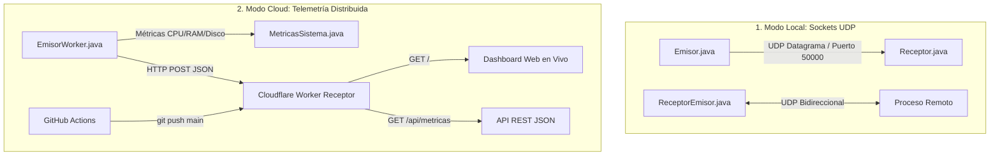

# Sistemas Distribuidos: Comunicación por Sockets y Telemetría Cloud

Repositorio de la asignatura **Sistemas Distribuidos**: [https://github.com/Nandofernando28/SistemasDistribuidos](https://github.com/Nandofernando28/SistemasDistribuidos)

Este proyecto implementa dos paradigmas de comunicación y monitoreo distribuido:
1. **Comunicación Local por Datagramas UDP:** Sockets sin conexión (`DatagramSocket` y `DatagramPacket`) para intercambio directo entre procesos.
2. **Telemetría Distribuida en la Nube (Cloudflare Workers):** Emisor en Java que recopila métricas del sistema (CPU, RAM, Disco) y las envía vía HTTP/JSON a un **Receptor Serverless** desplegado en el Edge con Cloudflare Workers y un Dashboard Web en tiempo real.

---

## 🏛️ Arquitectura del Sistema



---

## 📂 Estructura del Repositorio

```text
SistemasDistribuidos/
├── .github/
│   └── workflows/
│       └── deploy.yml            # CI/CD: Despliegue automatico a Cloudflare Workers
├── worker/                       # Receptor Serverless (Cloudflare Worker)
│   ├── src/
│   │   └── index.js              # Codigo del Worker (Receptor + Dashboard Web)
│   ├── package.json              # Scripts y dependencias
│   ├── wrangler.toml             # Configuracion de Cloudflare
│   └── README.md                 # Guia especifica del Worker
├── Emisor.java                   # Emisor UDP Datagrama original
├── Receptor.java                 # Receptor UDP Datagrama original
├── ReceptorEmisor.java           # Proceso Duplex UDP
├── MetricasSistema.java          # Extraccion de metricas de CPU, RAM y Disco
├── EmisorWorker.java             # Emisor HTTP hacia el Worker de Cloudflare
├── comandos.md                   # Resumen rapido de comandos de consola
├── .gitignore                    # Exclusion de binarios, .class y node_modules
└── README.md                     # Documentacion general del proyecto
```

---

## 🚀 Guía de Uso

### 1. Compilación de los Programas en Java
Desde la raíz del proyecto, ejecuta:
```powershell
javac -d bin MetricasSistema.java Emisor.java Receptor.java ReceptorEmisor.java EmisorWorker.java
```

---

### 2. Modo Local: Sockets UDP (Ejercicio de Clase)

#### Paso A: Iniciar el Receptor UDP
```powershell
java -cp bin socket.sinconexion.simplex.Receptor 50000
```

#### Paso B: Enviar métricas desde el Emisor UDP
* **Envío único de métricas del sistema:**
  ```powershell
  java -cp bin socket.sinconexion.simplex.Emisor 127.0.0.1 50000
  ```
* **Envío continuo cada 3 segundos (PowerShell):**
  ```powershell
  while ($true) { java -cp bin socket.sinconexion.simplex.Emisor 127.0.0.1 50000; Start-Sleep -Seconds 3 }
  ```
* **Envío de mensaje de texto personalizado:**
  ```powershell
  java -cp bin socket.sinconexion.simplex.Emisor 127.0.0.1 50000 "Hola mundo desde Java"
  ```

---

### 3. Modo Cloud: Receptor en Cloudflare Workers

#### Paso A: Ejecutar el Worker localmente (o desplegarlo)
```powershell
cd worker
npm install
npm run dev
```
El worker quedará escuchando en `http://localhost:8787` con su **Dashboard Web** disponible en el navegador.

#### Paso B: Enviar telemetría desde Java hacia el Worker
Abre otra terminal en la raíz del proyecto y ejecuta:

* **Envío continuo de métricas al Worker (Local):**
  ```powershell
  while ($true) { java -cp bin socket.sinconexion.simplex.EmisorWorker http://localhost:8787; Start-Sleep -Seconds 3 }
  ```

* **Envío continuo al Worker desplegado en Cloudflare:**
  ```powershell
  while ($true) { java -cp bin socket.sinconexion.simplex.EmisorWorker https://sistemas-distribuidos-receptor.jbdb-backend.workers.dev; Start-Sleep -Seconds 3 }
  ```

---

## ☁️ Despliegue en Cloudflare & GitHub

### Opción 1: Despliegue directo desde tu terminal
1. Iniciar sesión en Cloudflare:
   ```bash
   cd worker
   npx wrangler login
   ```
2. Desplegar el Worker:
   ```bash
   npm run deploy
   ```

### Opción 2: Despliegue automático vía GitHub Actions (CI/CD)
1. Ve a tu repositorio en GitHub: [Nandofernando28/SistemasDistribuidos](https://github.com/Nandofernando28/SistemasDistribuidos)
2. Entra en **Settings** -> **Secrets and variables** -> **Actions**.
3. Añade el secreto `CLOUDFLARE_API_TOKEN` con un token creado desde el panel de Cloudflare (con permisos *Edit Cloudflare Workers*).
4. Cada vez que hagas `git push origin main`, GitHub Actions desplegará tu Worker automáticamente.

---

## 👨‍💻 Autor
- **Repositorio:** [github.com/Nandofernando28/SistemasDistribuidos](https://github.com/Nandofernando28/SistemasDistribuidos)
- Asignatura: **Sistemas Distribuidos**
